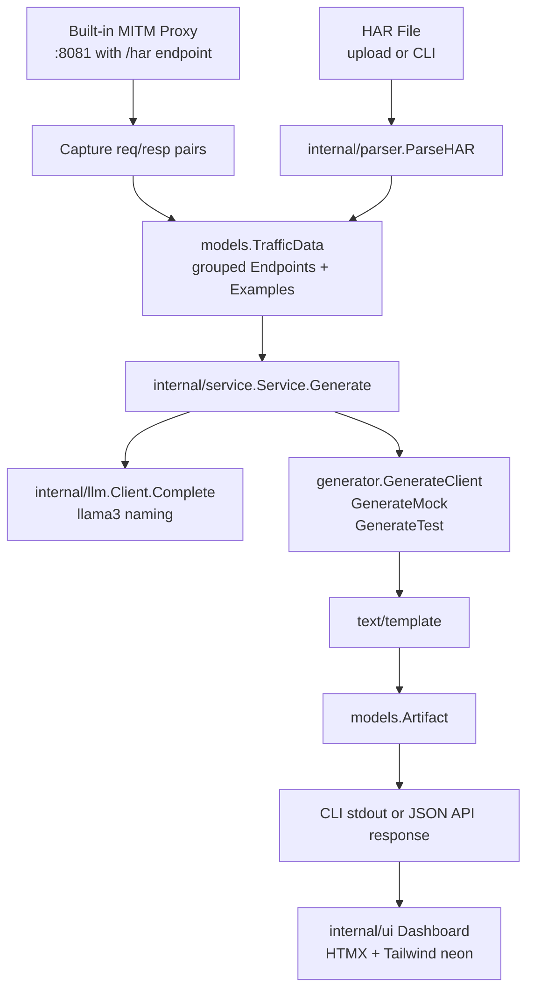

<!-- header:start -->
<div align="center">



<a href="#-quick-start"></a>

<a href="LICENSE"></a>

<a href="https://github.com/ajendras/netscribe/stargazers"></a>
<a href="https://github.com/ajendras/netscribe/actions/workflows/ci.yml"></a>

<a href="CONTRIBUTING.md"></a>

**Turns network traffic into typed API clients, mocks, and tests using local LLMs**

[✨ Features](#-features) • [⚡ Quick start](#-quick-start) • [🧰 Usage](#-usage) • [🧩 Architecture](#-architecture) • [📍 Roadmap](#-roadmap) • [🤝 Contributing](#-contributing)

</div>
<!-- header:end -->

## ✨ Why NetScribe?

Developers waste hours writing boilerplate API clients, crafting realistic mocks for dev and CI, and authoring tests that actually match production responses. Existing solutions are manual, cloud-only, or lack intelligence for naming and edge cases. **NetScribe** is a local-first web app for frontend and full-stack engineers who want instant, accurate artifacts from real traffic without sending data off-device.

- **Instant artifacts** — Drag in a HAR file and receive fully-typed clients, dynamic mocks, and production-aligned tests in seconds
- **Local & Private** — All inference runs on-device via Ollama; zero telemetry and no data ever leaves your machine
- **LLM Intelligence** — Smart endpoint naming, natural method names, and schema hints powered by local models
- **Multi-target output** — Generate TypeScript, Go, or Python clients plus Node mocks and Go tests from the same traffic

## 🎬 Demo

<p align="center"></p>

## 🚀 Features

<table>
<tr>
<td align="center" width="33%">
🚀 <b>HAR Ingestion</b><br>
Drag-and-drop or upload HAR files for instant structured parsing
</td>
<td align="center" width="33%">
🧠 <b>Local LLM</b><br>
Queries Ollama to intelligently name endpoints and infer types
</td>
<td align="center" width="33%">
🌐 <b>Multi-Language</b><br>
Outputs TypeScript, Go, and Python clients from one traffic set
</td>
</tr>
<tr>
<td align="center" width="33%">
🧪 <b>Test Generation</b><br>
Produces ready-to-run test suites with real-data assertions
</td>
<td align="center" width="33%">
🎭 <b>Dynamic Mocks</b><br>
Creates mock servers and fixtures that vary by observed patterns
</td>
<td align="center" width="33%">
🌃 <b>Neon UI</b><br>
Synthwave-styled responsive dashboard with live previews
</td>
</tr>
<tr>
<td align="center" width="33%">
⚡ <b>CLI + Web</b><br>
Use via beautiful UI or headless CLI for CI workflows
</td>
<td align="center" width="33%">
🔒 <b>Privacy First</b><br>
Zero telemetry; everything stays on your machine
</td>
<td align="center" width="33%">
🔍 <b>Live MITM Proxy</b><br>
Capture live traffic directly; no more manual HAR exports from devtools
</td>
</tr>
</table>

## 📦 Installation

**Requirements**

- Go 1.21+
- Ollama running locally with a model such as `llama3` (used by default)

```bash
go install github.com/ajendras/netscribe@latest
```

Start the dashboard:

```bash
netscribe serve
```

Or generate directly from the CLI (see Quick start).

## ⚡ Quick start

```bash
# Generate a TypeScript client from a recorded HAR file
netscribe generate \
  --file api.har \
  --type client \
  --lang typescript \
  --out client.ts
```

The resulting `client.ts` contains a ready-to-use `ApiClient` class with methods derived from your traffic (LLM-enhanced names when Ollama is available).

```bash
# Live capture with the built-in proxy (no manual HAR export)
netscribe proxy --port 8081
```

Configure your browser or `http_proxy` to `http://localhost:8081`, exercise your APIs, then download the capture with `curl -o capture.har http://localhost:8081/har`.

## 🧰 Usage

### Start the synthwave dashboard

```bash
netscribe serve --port 8080 --ollama-host http://localhost:11434
```

Open http://localhost:8080, drag in a `.har` file, preview the parsed endpoints, then generate and copy clients, mocks, or tests with one click.

### Live traffic with built-in MITM proxy

```bash
netscribe proxy --port 8081
```

The proxy captures requests and responses into `models.TrafficData`. Configure your environment:

```bash
export http_proxy=http://localhost:8081
# or set proxy settings in your browser/OS
```

Perform API calls, then export:

```bash
curl -o capture.har http://localhost:8081/har
curl -X POST http://localhost:8081/clear   # reset capture
```

Use the resulting HAR with the dashboard or CLI. HTTPS is tunneled (full TLS MITM with CA is planned for future).

### CLI: Generate a Go client

```bash
netscribe generate --file traffic.har --type client --lang go --out client.go
```

### CLI: Generate a dynamic mock server

```bash
netscribe generate --file traffic.har --type mock --out mock-server.js
```

The output is a self-contained Express server with fixtures taken from the first observed response per endpoint.

<details>
<summary>Generate a table-driven test suite</summary>

```bash
netscribe generate --file traffic.har --type test --lang go --out client_test.go
```

The test spins up an in-memory `httptest.Server` that replays the exact status codes and bodies captured in the HAR.
</details>

<details>
<summary>Advanced: Use the library directly</summary>

```go
package main

import (
	"fmt"
	"os"

	"github.com/netscribe/netscribe/internal/llm"
	"github.com/netscribe/netscribe/internal/models"
	"github.com/netscribe/netscribe/internal/parser"
	"github.com/netscribe/netscribe/internal/service"
)

func main() {
	data, _ := os.ReadFile("api.har")
	traffic, _ := parser.ParseHAR(data)

	svc := service.New(llm.NewClient())
	artifact, _ := svc.Generate(models.GenerateRequest{
		Traffic: traffic,
		Type:    "client",
		Lang:    "python",
	})

	fmt.Println(artifact.Content)
}
```
</details>

## 🔧 Configuration

| Option          | Default                    | Description |
|-----------------|----------------------------|-----------|
| `--port`, `-p`  | `8080`                     | Port for the web dashboard (`serve` command) |
| `--port`, `-p`  | `8081`                     | Port for the MITM proxy (`proxy` command) |
| `--ollama-host` | `http://localhost:11434`   | Ollama API endpoint; also respects `OLLAMA_HOST` env var |
| `--file`, `-f`  | (required)                 | Path to input HAR file (`generate` command) |
| `--type`        | `client`                   | Artifact type: `client`, `mock`, or `test` |
| `--lang`        | `typescript` (client) / `go` (test) | Output language: `typescript`, `go`, `python` |
| `--out`, `-o`   | `-` (stdout)               | Output file path |

## 🧩 Architecture



NetScribe follows a clean pipeline: raw HAR is parsed into `TrafficData`, optionally enriched with LLM-derived names via `service.enrichWithLLM`, then dispatched to the appropriate generator. The same core path powers both the Chi/Templ web UI and the Cobra CLI, keeping all processing local. The new proxy accumulates directly into `TrafficData` via `AddExample` and exports via `parser.ToHAR`.

## 📁 Project structure

```text
.
├── cmd/netscribe/
│   └── main.go                 # Cobra CLI: 'serve' and 'generate' commands with all flags
├── internal/
│   ├── server/
│   │   └── server.go           # New() creates Chi router, mounts handlers and Templ UI
│   ├── handlers/
│   │   └── handlers.go         # UploadHAR, Generate, JSON responses
│   ├── service/
│   │   └── service.go          # Service.Generate + enrichWithLLM using LLM interface
│   ├── parser/
│   │   └── parser.go           # ParseHAR, groups by method+path, extracts bodies
│   ├── generator/
│   │   ├── client.go           # GenerateClient + language templates (ts/go/python)
│   │   ├── mock.go             # GenerateMock (Node/Express with fixtures)
│   │   └── test.go             # GenerateTest (Go httptest table-driven tests)
│   ├── llm/
│   │   └── ollama.go           # Client.Complete with retries, streaming, OLLAMA_HOST
│   ├── models/
│   │   └── models.go           # TrafficData, Endpoint, GenerateRequest, Artifact,
│   │                           # InferSchema(), ToOpenAPI()
│   └── ui/
│       └── ui.templ            # Dashboard(), Tailwind synthwave neon styling
├── tailwind.config.js          # Synthwave palette (#ff00aa, #00f3ff), glow utilities
├── tests/
│   └── integration_test.go     # Full pipeline tests using embedded sample.har + mockLLM
├── go.mod
└── LICENSE
```

## 🧪 Testing

```bash
go test ./... -v
```

Covers parser edge cases, generator template output, service orchestration, LLM enrichment (via `mockLLM`), `models.ToOpenAPI`, and full end-to-end pipelines with golden assertions against `sample.har`.

## 📍 Roadmap
<!-- roadmap:start -->
- [x] **v0.1.0** — first release: HAR Ingestion, Local LLM, Multi-Language, Test Generation
- [x] Add built-in MITM proxy for live traffic capture without manual HAR export
- [ ] Generate framework-specific bindings (TanStack Query, React Query, tRPC)
- [ ] Add Python (httpx+pytest) and Rust (reqwest) output targets
- [ ] Embed a runnable mock server that serves generated fixtures on localhost
- [ ] Build interactive request/response inspector with syntax highlighting
- [ ] Allow schema editing before code generation in the UI
- [ ] Implement project save/load with multiple HAR sessions
- [ ] Add model picker and system-prompt editor for Ollama
- [ ] Support import/export of OpenAPI 3.1 specifications
- [ ] Create a companion VS Code extension that calls the local service
- [ ] Include coverage reporting on how many code paths the generated tests exercise
- [ ] Add GraphQL endpoint detection and client generation

> 🤖 This roadmap is worked through continuously — ideas and PRs welcome!
<!-- roadmap:end -->

## 🤝 Contributing

We love contributions! Please read [CONTRIBUTING.md](CONTRIBUTING.md) and adhere to our [CODE_OF_CONDUCT.md](CODE_OF_CONDUCT.md). Good first issues are clearly labeled and make a perfect place to start. Feel free to open PRs that improve the neon UI, add new generator languages, or tighten LLM prompts.

## 📄 License

MIT © NetScribe contributors — see the [LICENSE](LICENSE) file for details.

<!-- footer:start -->
<div align="center">

### ⭐ Star history

<a href="https://star-history.com/#ajendras/netscribe&Date"></a>

If **NetScribe** saves you time, a ⭐ helps others find it.

Made with ❤️ by [Ajendra](https://ajendra.info)


</div>
<!-- footer:end -->
